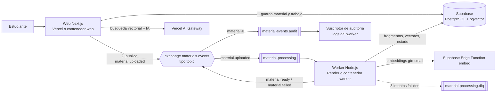

# Flashcards AI: prueba de concepto con RabbitMQ

Plataforma de estudio que convierte apuntes propios (PDF, TXT o texto pegado) en flashcards y preguntas de opción múltiple, y recomienda qué temas repasar según las respuestas del estudiante.

## Probar la aplicación desplegada

1. Abrir la URL de la aplicación entregada junto con el trabajo y entrar en **Iniciar sesión** (`/login`).
2. Usar la cuenta de prueba:

   - **Email:** `admin@example.com`
   - **Contraseña:** `admin1`

3. En **Flashcards**, ingresar un tema, elegir el nivel y seleccionar **Generar flashcards**.
4. Abrir **Study sets** y buscar el pedido en **Generaciones recientes**. Cuando figure **Listo**, elegir **Abrir set** para estudiar las tarjetas. El estado se actualiza automáticamente.
5. Para probar material propio, entrar en **RAG con material**, subir [`samples/photosynthesis.txt`](flashcards-ai/samples/photosynthesis.txt), esperar a que esté listo y generar tarjetas o preguntas desde las secciones de RAG. Los resultados también se consultan en **Study sets**.

La generación se realiza en segundo plano y puede demorar. Si permanece en **En cola** durante varios minutos, consultar [Si una generación queda en cola](#si-una-generación-queda-en-cola).

> La URL pública de la web todavía no está indicada en este repositorio. Para ejecutar el proyecto en una computadora, seguir [Ejecución local con Docker](#ejecución-local-con-docker).

La PoC demuestra **RabbitMQ como bus de eventos pub/sub**: la carga de un material no espera el procesamiento. La web publica el evento `material.uploaded` en un exchange `topic`. Un worker independiente lo consume para fragmentar el texto, generar vectores en Supabase y preparar tres tarjetas iniciales. Al terminar, el worker publica `material.ready` o `material.failed`. Un segundo suscriptor (auditoría) recibe todos los eventos por su propia cola, sin que el productor lo conozca.

## Arquitectura



### Eventos y colas

| Elemento | Tipo | Qué hace |
|---|---|---|
| `materials.events` | Exchange `topic`, durable | Recibe todos los eventos de materiales. La routing key es el tipo de evento. |
| `material.uploaded` | Evento (web → exchange) | Material recibido. Cuerpo: `eventId`, `type`, `jobId`, `documentId`, `occurredAt`. |
| `material.ready` / `material.failed` | Eventos (worker → exchange) | Resultado del procesamiento. |
| `material-processing` | Cola durable, binding `material.uploaded` | Cola de trabajo. El worker la consume con `prefetch(1)` y confirma (`ack`) solo después de persistir. |
| `material-events.audit` | Cola durable, binding `material.#`, máx. 1000 mensajes | Segundo suscriptor: registra cada evento en los logs del worker. |
| `material-processing.dlq` | Cola durable | Recibe el mensaje después de 3 intentos fallidos. El material queda en estado `failed`. |

Los mensajes solo transportan identificadores; el texto del apunte queda en Supabase. La web publica con *publisher confirms* y declara exchange, cola y binding antes de publicar, para que el mensaje no se pierda aunque el worker todavía no haya arrancado. La topología está definida en un único archivo: [`worker/events.mjs`](flashcards-ai/worker/events.mjs).

## Requisitos para ejecutar localmente

- Docker Desktop con Compose v2.24 o superior.
- El archivo `.env` entregado junto con el trabajo y una conexión a internet para acceder a Supabase y al servicio de IA.

## Ejecución local con Docker

1. Iniciar Docker Desktop y esperar a que el motor esté activo.
2. Colocar el archivo `.env` entregado en la carpeta `flashcards-ai`, junto a `compose.yaml`, y abrir una terminal en esa carpeta.
3. Construir e iniciar los tres servicios:

```bash
docker compose up --build
```

4. Esperar a que arranquen y abrir http://localhost:3000. Iniciar sesión con la cuenta de prueba indicada arriba.

Si las variables están en `.env.local` en lugar de `.env`, ejecutar `docker compose --env-file .env.local up --build` en el paso 3. Compose inicia la web, el worker y RabbitMQ local; **Supabase y Vercel AI Gateway siguen siendo servicios externos**.

| Servicio | URL |
|---|---|
| Web | http://localhost:3000 |
| Panel de RabbitMQ | http://localhost:15672 |
| Logs del worker | `docker compose logs -f worker` |

Para comprobar los servicios y ver los logs desde otra terminal en la misma carpeta:

```bash
docker compose ps
docker compose logs -f worker
```

Si se usó `.env.local`, agregar `--env-file .env.local` después de `docker compose` en esos comandos. Al arrancar, el worker muestra `Worker esperando trabajos en material-processing`. Para detener la ejecución, presionar `Ctrl+C` en la terminal donde corre Compose; para detener y retirar los contenedores, ejecutar `docker compose down` (con `--env-file .env.local` si corresponde).

## Guion de prueba

Con sesión iniciada, la generación de flashcards y opción múltiple se envía a segundo plano. Se puede navegar mientras el worker procesa el pedido y consultar el estado y el set completo en **Study sets**. Las preguntas generadas se pueden practicar desde el set. Los trabajos fallidos se muestran en esa pantalla; se puede volver a solicitar la generación. Sin iniciar sesión, la generación general conserva su funcionamiento anterior y no se guarda automáticamente. Para usar esta función en la nube, hay que desplegar la versión actual tanto de la web como del worker y conectar ambos al mismo RabbitMQ y Supabase.

Datos de prueba: [`samples/photosynthesis.txt`](flashcards-ai/samples/photosynthesis.txt), unos 1900 caracteres en inglés (el modelo de embeddings `gte-small` está orientado a inglés).

1. **Iniciar sesión** con la cuenta de prueba indicada arriba, o registrar un usuario en `/register`. Según la configuración de Supabase, puede ser necesario confirmar el email.
2. **Revisar la topología** en el panel de RabbitMQ:
   - En *Exchanges* aparece `materials.events` (topic).
   - Sus *Bindings* apuntan a `material-processing` con `material.uploaded` y a `material-events.audit` con `material.#`.
   - En *Queues*, `material-processing`, `material-events.audit` y `generation-processing` deben tener al menos un consumidor cuando el worker está activo.
3. **Cargar el material**. Ir a *RAG con material*, elegir *Subir archivo*, seleccionar `samples/photosynthesis.txt` y guardar.
   - Resultado esperado: respuesta inmediata y una tarjeta con estado *En cola*, que pasa a *Procesando* y después a *Listo para estudiar*. La pantalla se actualiza sola cada 5 segundos.
   - El material muestra 3 fragmentos. Si hay clave de IA, también muestra *Ver tarjetas iniciales* con 3 tarjetas.
4. **Ver el pub/sub en los logs del worker** (`docker compose logs -f worker`):

   ```text
   [auditoría] material.uploaded job=1a2b3c4d documento=5e6f7a8b ...
   Trabajo 1a2b3c4d-... listo (3 fragmentos, 3 tarjetas iniciales)
   [auditoría] material.ready job=1a2b3c4d documento=5e6f7a8b ...
   ```

   El mismo evento `material.uploaded` llegó a dos colas: una lo procesó y la otra lo auditó.
5. **Generar con RAG** (requiere clave de IA). En *RAG > Flashcards*, seleccionar el material y escribir el tema `photosynthesis` o `Calvin cycle`.
   - Ir a **Study sets** y esperar a que el pedido esté listo; allí se abre el set con 10 tarjetas basadas en el texto.
   - En *RAG > Opción múltiple*, elegir 5 preguntas y responderlas.
6. **Temas a reforzar**. Después de responder al menos 5 preguntas de un tema, *Inicio* muestra la precisión del tema y el enlace *Practicar este tema*.
7. **Reintentos y DLQ (falla controlada)**. En el panel de RabbitMQ, abrir el exchange `materials.events` y usar *Publish message* con:
   - Routing key: `material.uploaded`.
   - Payload: `{"jobId":"00000000-0000-0000-0000-000000000000"}`.

   Resultado esperado: el worker registra `Falló trabajo ..., intento 1`, `intento 2` e `intento 3`. Después, el mensaje queda en `material-processing.dlq` y la auditoría registra `material.failed`. Ningún dato real se modifica.

## Endpoints

Todas las rutas de RAG requieren sesión (cookie de Supabase). La forma más simple de probarlas es la interfaz.

| Método y ruta | Uso | Respuesta esperada |
|---|---|---|
| `POST /api/rag/documents` | Carga un material (JSON `{ name, content }` o `multipart/form-data` con `name` y `file`). | `201` con `document.status = "queued"`; `503` si no hay conexión con RabbitMQ. |
| `GET /api/rag/documents` | Lista materiales con estado y tarjetas iniciales. | `200` con `documents[]`. |
| `DELETE /api/rag/documents/{id}` | Elimina un material y sus fragmentos. | `200`. |
| `POST /api/rag/flashcards` | `{ topic, level, documentIds }` → 10 tarjetas. | `200` con `cards[]`. |
| `POST /api/rag/multiple-choice` | `{ topic, level, count, documentIds }` → preguntas adaptativas. | `200` con `questions[]` y `trackingEnabled: true`. |
| `POST /api/flashcards`, `POST /api/multiple-choice` | Generación sin material (pública). | `200`. |
| `POST /api/multiple-choice/attempts` | Registra una respuesta (idempotente). | `200` o `201`. |
| `GET/POST /api/study-sets`, `GET /api/study-sets/{id}` | Sets guardados. | `200` / `201`. |

## Verificación del código

```bash
npm ci
npm test        # tests del worker, de los eventos y del motor adaptativo
npm run lint
npm run build
```

## Si una generación queda en cola

1. En **Study sets**, revisar el estado en **Generaciones recientes**. Render puede tardar en despertar si el worker estaba dormido.
2. Si sigue en cola durante varios minutos, revisar los logs y el despliegue del worker en Render. Verificar que la web y el worker usen el mismo Supabase y RabbitMQ y que ambos tengan la versión actual del código.
3. En RabbitMQ Manager, comprobar que `generation-processing` tenga al menos un consumidor. Que la URL del worker responda `ready` no confirma por sí solo que esté consumiendo esa cola.
4. Tras conectar el worker correcto, los pedidos pendientes deberían recuperarse y procesarse; el resultado aparece en **Study sets**. Si el estado cambia a **Falló**, volver a solicitar la generación.

## Limitaciones conocidas

- Supabase (base, Auth y Edge Functions) y Vercel AI Gateway son servicios gestionados externos. Compose levanta los servicios propios de la PoC: broker, web y worker.
- La escritura en la base y la publicación del evento no forman una transacción. Si la publicación falla, la API elimina el material y devuelve `503`. Un corte entre ambos pasos podría dejar un trabajo sin publicar; la mejora para producción es el patrón *outbox*.
- Los reintentos son inmediatos (sin *backoff*) y la DLQ se revisa manualmente.
- `gte-small` está orientado a inglés: la búsqueda sobre apuntes en español puede recuperar fragmentos menos relevantes. No se incluye OCR.
- El contenido generado por IA puede contener errores y debe revisarse.
- Las métricas adaptativas son autoevaluación, no una evaluación a prueba de manipulación.
