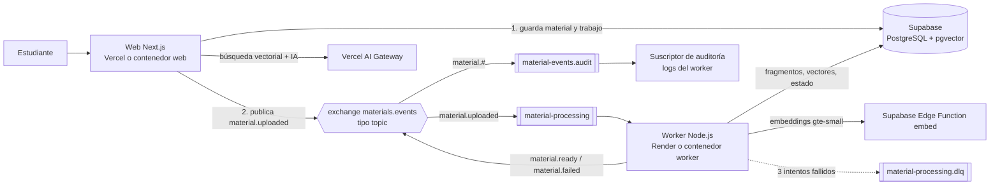

# Flashcards AI: prueba de concepto con RabbitMQ

Plataforma de estudio que convierte apuntes propios (PDF, TXT o texto pegado) en flashcards y preguntas de opción múltiple, y recomienda qué temas repasar según las respuestas del estudiante.

La PoC demuestra **RabbitMQ como bus de eventos pub/sub**: la carga de un material no espera el procesamiento. La web publica el evento `material.uploaded` en un exchange `topic`. Un worker independiente lo consume para fragmentar el texto, generar vectores en Supabase y preparar tres tarjetas iniciales. Al terminar, el worker publica `material.ready` o `material.failed`. Un segundo suscriptor (auditoría) recibe todos los eventos por su propia cola, sin que el productor lo conozca.

## Arquitectura



### Eventos y colas

| Elemento | Tipo | Qué hace |
|---|---|---|
| `materials.events` | Exchange `topic`, durable | Recibe todos los eventos de materiales. La routing key es el tipo de evento. |
| `material.uploaded` | Evento (web → exchange) | Material recibido. Cuerpo: `eventId`, `type`, `jobId`, `documentId`, `occurredAt`. |
| `material.ready` / `material.failed` | Eventos (worker → exchange) | Resultado del procesamiento. |
| `material-processing` | Cola durable, binding `material.uploaded` | Cola de trabajo. El worker la consume con `prefetch(1)` y confirma (`ack`) solo después de persistir. |
| `material-events.audit` | Cola durable, binding `material.#`, máx. 1000 mensajes | Segundo suscriptor: registra cada evento en los logs del worker. |
| `material-processing.dlq` | Cola durable | Recibe el mensaje después de 3 intentos fallidos. El material queda en estado `failed`. |

Los mensajes solo transportan identificadores; el texto del apunte queda en Supabase. La web publica con *publisher confirms* y declara exchange, cola y binding antes de publicar, para que el mensaje no se pierda aunque el worker todavía no haya arrancado. La topología está definida en un único archivo: [`worker/events.mjs`](worker/events.mjs).

## Requisitos

- Docker Desktop con Compose v2.24 o superior.
- Un proyecto de Supabase con las migraciones de `supabase/migrations` aplicadas y la Edge Function `embed` desplegada.
- Para generar contenido con IA: una clave de Vercel AI Gateway (`AI_GATEWAY_API_KEY`). Sin ella, la carga, la cola y el indexado funcionan, pero no se generan tarjetas ni preguntas.
- Node.js 22 o superior, solo si se ejecuta sin Docker.

## Configuración

```bash
cp .env.example .env   # completar los valores
```

| Variable | Dónde se usa | Notas |
|---|---|---|
| `NEXT_PUBLIC_SUPABASE_URL` | web y worker | URL del proyecto Supabase. |
| `NEXT_PUBLIC_SUPABASE_PUBLISHABLE_KEY` | web | Clave publicable. |
| `SUPABASE_SERVICE_ROLE_KEY` | solo worker | **Secreta.** Nunca subirla a Git ni configurarla en Vercel. |
| `RABBITMQ_URL` | web y worker | En Compose se usa el broker local automáticamente. En la nube, la URL `amqps://` de CloudAMQP. |
| `AI_GATEWAY_API_KEY` | web y worker | Opcional para la cola; necesaria para generar contenido. |
| `AI_GATEWAY_MODEL` | web y worker | Opcional. Por defecto `nvidia/nemotron-3.5-lightning-free`. |
| `NEXT_PUBLIC_WORKER_WAKE_URL` | web (Vercel) | URL pública del worker en Render. |

Preparar Supabase una sola vez (revisar primero el *dry run*):

```bash
npx supabase db push --dry-run
npx supabase db push
npx supabase functions deploy embed
```

## Ejecución local

```bash
docker compose up --build
```

Si las variables están en `.env.local` en lugar de `.env`, usar `docker compose --env-file .env.local up --build`.

| Servicio | URL |
|---|---|
| Web | http://localhost:3000 |
| Panel de RabbitMQ | http://localhost:15672 (usuario y clave de desarrollo: `guest` / `guest`) |
| Logs del worker | `docker compose logs -f worker` |

Al arrancar, el worker muestra `Worker esperando trabajos en material-processing`.

## Guion de prueba

Datos de prueba: [`samples/photosynthesis.txt`](samples/photosynthesis.txt), unos 1900 caracteres en inglés (el modelo de embeddings `gte-small` está orientado a inglés).

1. **Registrar un usuario** en `/register`. Según la configuración de Supabase, puede ser necesario confirmar el email.
2. **Revisar la topología** en el panel de RabbitMQ:
   - En *Exchanges* aparece `materials.events` (topic).
   - Sus *Bindings* apuntan a `material-processing` con `material.uploaded` y a `material-events.audit` con `material.#`.
   - En *Queues* aparecen las tres colas. `material-processing` y `material-events.audit` tienen 1 consumidor cada una.
3. **Cargar el material**. Ir a *RAG con material*, elegir *Subir archivo*, seleccionar `samples/photosynthesis.txt` y guardar.
   - Resultado esperado: respuesta inmediata y una tarjeta con estado *En cola*, que pasa a *Procesando* y después a *Listo para estudiar*. La pantalla se actualiza sola cada 5 segundos.
   - El material muestra 3 fragmentos. Si hay clave de IA, también muestra *Ver tarjetas iniciales* con 3 tarjetas.
4. **Ver el pub/sub en los logs del worker** (`docker compose logs -f worker`):

   ```text
   [auditoría] material.uploaded job=1a2b3c4d documento=5e6f7a8b ...
   Trabajo 1a2b3c4d-... listo (3 fragmentos, 3 tarjetas iniciales)
   [auditoría] material.ready job=1a2b3c4d documento=5e6f7a8b ...
   ```

   El mismo evento `material.uploaded` llegó a dos colas: una lo procesó y la otra lo auditó.
5. **Generar con RAG** (requiere clave de IA). En *RAG > Flashcards*, seleccionar el material y escribir el tema `photosynthesis` o `Calvin cycle`.
   - Resultado esperado: 10 tarjetas basadas en el texto.
   - En *RAG > Opción múltiple*, elegir 5 preguntas y responderlas.
6. **Temas a reforzar**. Después de responder al menos 5 preguntas de un tema, *Inicio* muestra la precisión del tema y el enlace *Practicar este tema*.
7. **Reintentos y DLQ (falla controlada)**. En el panel de RabbitMQ, abrir el exchange `materials.events` y usar *Publish message* con:
   - Routing key: `material.uploaded`.
   - Payload: `{"jobId":"00000000-0000-0000-0000-000000000000"}`.

   Resultado esperado: el worker registra `Falló trabajo ..., intento 1`, `intento 2` e `intento 3`. Después, el mensaje queda en `material-processing.dlq` y la auditoría registra `material.failed`. Ningún dato real se modifica.

## Endpoints

Todas las rutas de RAG requieren sesión (cookie de Supabase). La forma más simple de probarlas es la interfaz.

| Método y ruta | Uso | Respuesta esperada |
|---|---|---|
| `POST /api/rag/documents` | Carga un material (JSON `{ name, content }` o `multipart/form-data` con `name` y `file`). | `201` con `document.status = "queued"`; `503` si no hay conexión con RabbitMQ. |
| `GET /api/rag/documents` | Lista materiales con estado y tarjetas iniciales. | `200` con `documents[]`. |
| `DELETE /api/rag/documents/{id}` | Elimina un material y sus fragmentos. | `200`. |
| `POST /api/rag/flashcards` | `{ topic, level, documentIds }` → 10 tarjetas. | `200` con `cards[]`. |
| `POST /api/rag/multiple-choice` | `{ topic, level, count, documentIds }` → preguntas adaptativas. | `200` con `questions[]` y `trackingEnabled: true`. |
| `POST /api/flashcards`, `POST /api/multiple-choice` | Generación sin material (pública). | `200`. |
| `POST /api/multiple-choice/attempts` | Registra una respuesta (idempotente). | `200` o `201`. |
| `GET/POST /api/study-sets`, `GET /api/study-sets/{id}` | Sets guardados. | `200` / `201`. |

## Verificación del código

```bash
npm ci
npm test        # tests del worker, de los eventos y del motor adaptativo
npm run lint
npm run build
```

La prueba de integración opcional `scripts/smoke-rag.cjs` crea un usuario y un material temporales en el proyecto Supabase configurado, los procesa mediante el RabbitMQ local y los elimina al finalizar. No ejecutarla contra datos de producción. En PowerShell: `$env:RUN_REMOTE_SMOKE='1'; node --env-file=.env.local scripts/smoke-rag.cjs`.

## Despliegue en la nube

| Componente | Servicio |
|---|---|
| Web (Next.js) | Vercel, con directorio raíz `flashcards-ai` |
| Worker | Render, servicio web gratuito definido en [`../render.yaml`](../render.yaml) |
| Broker | CloudAMQP (RabbitMQ gestionado) |
| Base, Auth y embeddings | Supabase |
| IA de texto | Vercel AI Gateway |

### Worker en Render

1. En CloudAMQP, abrir la instancia y copiar la **AMQP URL** (`amqps://...`).
2. En Render: **New > Blueprint**, conectar el repositorio de GitHub y elegir la rama `main`. Render detecta `render.yaml` en la raíz.
3. Completar los secretos que pide el Blueprint:
   - `NEXT_PUBLIC_SUPABASE_URL`
   - `SUPABASE_SERVICE_ROLE_KEY`
   - `RABBITMQ_URL`: la URL de CloudAMQP.
   - `AI_GATEWAY_API_KEY`: opcional.

   Después, **Apply**.
4. Esperar el deploy. En *Logs* debe aparecer `Worker esperando trabajos en material-processing`. La URL pública (`https://<servicio>.onrender.com`) responde `ready`.
5. En el panel de CloudAMQP (*RabbitMQ Manager*), verificar el exchange `materials.events` y las colas `material-processing` y `material-events.audit`, cada una con 1 consumidor.

Alternativa manual (**New > Web Service**):

| Campo | Valor |
|---|---|
| Root Directory | `flashcards-ai` |
| Runtime | Node |
| Build Command | `npm ci --omit=dev` |
| Start Command | `node worker/index.mjs` |
| Instance Type | Free |
| Health Check Path | `/` |
| Variables | las mismas del paso 3 y `NODE_VERSION=22` |

### Web en Vercel

Configurar estas variables en el proyecto de Vercel y redesplegar. Las variables `NEXT_PUBLIC_*` se incorporan durante el build.

- `NEXT_PUBLIC_SUPABASE_URL` y `NEXT_PUBLIC_SUPABASE_PUBLISHABLE_KEY`.
- `RABBITMQ_URL`: la misma URL de CloudAMQP.
- `AI_GATEWAY_API_KEY`.
- `NEXT_PUBLIC_WORKER_WAKE_URL`: la URL de Render.

No configurar `SUPABASE_SERVICE_ROLE_KEY` en Vercel.

**Plan gratuito de Render.** El servicio se duerme tras unos 15 minutos sin tráfico HTTP. Mientras duerme, los mensajes esperan en la cola durable y no se pierden. Mientras haya materiales pendientes, la pantalla de materiales visita `NEXT_PUBLIC_WORKER_WAKE_URL` para despertarlo. El arranque en frío puede tardar alrededor de un minuto. Para la demo conviene abrir la URL del worker unos minutos antes.

### Acceso de evaluación

- URL de la web: _completar_.
- Usuario de prueba: _completar_. Entregar las credenciales por el canal privado de la cátedra, no en este repositorio.

## Limitaciones conocidas

- Supabase (base, Auth y Edge Functions) y Vercel AI Gateway son servicios gestionados externos. Compose levanta los servicios propios de la PoC: broker, web y worker.
- La escritura en la base y la publicación del evento no forman una transacción. Si la publicación falla, la API elimina el material y devuelve `503`. Un corte entre ambos pasos podría dejar un trabajo sin publicar; la mejora para producción es el patrón *outbox*.
- Los reintentos son inmediatos (sin *backoff*) y la DLQ se revisa manualmente.
- `gte-small` está orientado a inglés: la búsqueda sobre apuntes en español puede recuperar fragmentos menos relevantes. No se incluye OCR.
- El contenido generado por IA puede contener errores y debe revisarse.
- Las métricas adaptativas son autoevaluación, no una evaluación a prueba de manipulación.
