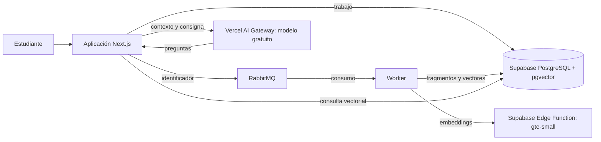

# Plataforma de estudio asistido: procesamiento asincrónico y refuerzo adaptativo

**Trabajo Práctico Integrador Final — Ingeniería de Software II**  
**Estado:** borrador técnico y funcional; completar integrantes, mediciones, despliegue y validación antes de entregar.

## 1. Problema y propuesta

Los estudiantes suelen distribuir sus apuntes y ejercicios entre herramientas diferentes y necesitan identificar qué temas requieren más práctica. El producto propone transformar materiales propios en tarjetas y preguntas, registrar respuestas y sugerir una práctica adaptada al rendimiento. La hipótesis de negocio es que reducir el tiempo de preparación y orientar el repaso favorece la continuidad del estudio; todavía debe validarse con usuarios mediante pruebas y medición de retención y uso.

La prueba de concepto se concentra en una historia no trivial: un estudiante autenticado carga un PDF con texto o pega sus apuntes; el sistema procesa los fragmentos en segundo plano, los indexa y prepara tres tarjetas iniciales. Una vez listo, el estudiante puede solicitar más actividades sobre un tema con recuperación vectorial. Las respuestas de opción múltiple alimentan estadísticas por tema y una recomendación de repaso. La generación automática inicial está implementada, pendiente de verificación integral.

## 2. Decisión técnica y arquitectura

Se seleccionó RabbitMQ por su encaje con trabajos de procesamiento distribuidos entre un productor y un consumidor. Al recibir un material, la aplicación guarda un trabajo y publica su identificador en una cola durable. Un worker lo consume, divide el contenido, solicita embeddings a una función de Supabase y guarda los vectores en PostgreSQL/pgvector. El usuario puede continuar interactuando mientras consulta el estado del material. Una vez listo, la aplicación recupera fragmentos por similitud y los envía a un modelo de texto gratuito a través de Vercel AI Gateway.

RabbitMQ confirma la publicación y el consumidor reconoce el mensaje tras persistir los resultados. Se realizan hasta tres intentos y luego se envía el mensaje a una cola de errores. La clave única de fragmento por documento y posición permite reescribir resultados de una repetición. Las confirmaciones y la durabilidad reducen ciertos riesgos, pero no constituyen una garantía de extremo a extremo: la escritura en base y la publicación no son una transacción atómica. Un corte entre ambas puede dejar un trabajo sin publicar; una mejora es implementar un patrón outbox. Las reconexiones, la concurrencia de varios workers y la recuperación desde la cola de errores requieren validación adicional. [Documentación de confiabilidad de RabbitMQ](https://www.rabbitmq.com/docs/reliability).

### Alternativas

| Alternativa | Ventaja para este caso | Costo o limitación |
|---|---|---|
| RabbitMQ | Cola de trabajo, confirmaciones y distribución a consumidores; adecuado para tareas de duración variable. | Broker adicional, operación y atención a duplicados y fallas. |
| Kafka | Registro de eventos y procesamiento por consumidores para flujos de gran escala y replay. | Mayor complejidad operativa para esta PoC; no se justifica por el volumen demostrado. |
| n8n | Orquestación visual e integración rápida de servicios. | Es un automatizador de flujos; el equipo tendría que resolver la integración y el control de trabajos con otro enfoque. [Documentación n8n](https://docs.n8n.io/). |

La decisión prioriza simplicidad y separación del procesamiento frente a la posibilidad de reproducción histórica de eventos. La PoC actual demuestra una cola de trabajo, no un pub/sub con múltiples suscriptores ni alta disponibilidad del broker.

## 3. Atributos de calidad y trade-offs

| Atributo | Escenario y medición propuesta | Decisión y límite |
|---|---|---|
| Rendimiento percibido | Medir tiempo desde envío hasta respuesta de aceptación y tiempo total hasta estado listo en diez cargas del mismo tamaño. | La API no espera el indexado; el resultado no es inmediato. Metas y percentiles aún no medidos. |
| Recuperabilidad | Interrumpir un worker durante un trabajo y verificar reentrega y ausencia de duplicados; registrar intentos y resultado. | Acknowledgement tras persistencia y reintentos limitados; falta probar el caso de corte entre base y publicación. |
| Modificabilidad | Medir el esfuerzo de agregar otro consumidor o cambiar el modelo de embeddings sin modificar la pantalla. | Un worker separado reduce acoplamiento, aunque exige contratos y migraciones compatibles. |

El desacoplamiento introduce consistencia eventual y más servicios para operar. `gte-small` está orientado a inglés; por eso los apuntes en español pueden recuperar fragmentos menos relevantes. La disponibilidad de los modelos gratuitos y cuotas de proveedores no es una garantía permanente. No se han validado métricas de aprendizaje, latencia, escalabilidad ni costos reales de producción.

## 4. Implementación y evidencia

La aplicación emplea Next.js y TypeScript, Supabase Auth/PostgreSQL/pgvector y Edge Functions, RabbitMQ, un worker Node.js y Vercel AI Gateway. El entorno local incluye web, worker y broker en Docker Compose; Supabase y la API de IA siguen siendo servicios externos. **Esto no cumple todavía el requisito de que Compose contenga todos los servicios necesarios:** resolver y demostrar una instalación autocontenida o consultar su aceptación con la cátedra.

Evidencia disponible a la fecha: una carga llegó a estado listo en un intento y almacenó tres fragmentos con vectores; la función de embeddings devolvió 384 dimensiones; una generación de diez flashcards respondió correctamente. Son comprobaciones puntuales, no una medición de calidad ni una prueba completa de recuperación y generación con un usuario. Faltan documentar el tiempo de respuesta, probar una falla/reentrega y verificar aislamiento entre usuarios.

## 5. Recursos, riesgos y próximos pasos

Para un producto real se necesitan desarrollo, pruebas, diseño, infraestructura, seguimiento de costos y validación con estudiantes. El esfuerzo y los costos deben estimarse con el tamaño real del equipo y las condiciones del proveedor; no se dispone aún de una estimación verificada. Los principales riesgos son contenido generado incorrecto, restricciones de servicios gratuitos, confiabilidad de publicación, seguridad de credenciales y búsqueda deficiente en español.

Antes de entregar: completar pruebas de extremo a extremo, datos de prueba reproducibles, despliegue cloud con credenciales seguras, métricas y un entorno Compose acorde con la consigna. Para la defensa: explicar producto, decisión y arquitectura, mostrar procesamiento con RabbitMQ, búsqueda y práctica, y ensayar la demostración de falla. No presentar mejoras futuras como si ya estuvieran implementadas.

Fuentes técnicas: [RabbitMQ](https://www.rabbitmq.com/docs/reliability), [Supabase búsqueda semántica](https://supabase.com/docs/guides/ai/semantic-search), [Supabase gte-small](https://huggingface.co/Supabase/gte-small), [n8n](https://docs.n8n.io/).
