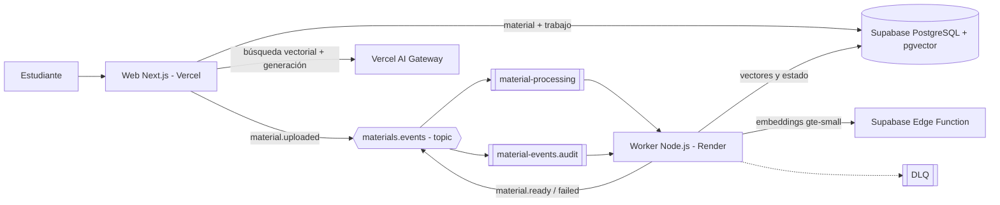

# Flashcards AI: procesamiento asincrónico con RabbitMQ para una plataforma de estudio adaptativa

**Trabajo Práctico Integrador Final — Ingeniería de Software II — 2.º cuatrimestre 2026**
**Integrantes:** _completar_
**Fecha de entrega:** 19 de noviembre de 2026

---

**Índice**

1. Problema y oportunidad
2. Producto e historia de usuario
3. Eje funcional: mensajería asincrónica y pub/sub
4. Eje técnico: RabbitMQ
5. Arquitectura y prueba de concepto
6. Alternativas evaluadas
7. Atributos de calidad y trade-offs
8. Riesgos, costos y próximos pasos

Anexo A: referencias.

---

## 1. Problema y oportunidad

Los estudiantes reparten apuntes, PDFs y ejercicios entre muchas herramientas. Antes de un examen dedican gran parte del tiempo a *preparar* el material (resumir, armar preguntas) en lugar de *practicar*. Además, les cuesta identificar qué temas dominan menos. Las herramientas genéricas de tarjetas exigen cargar el contenido a mano, y los chats de IA no recuerdan el desempeño ni se apoyan en los apuntes propios.

La oportunidad de negocio es reducir el tiempo de preparación y orientar el repaso. Si el estudiante sube sus apuntes y recibe actividades basadas en ellos, y el sistema le dice qué reforzar, aumenta la probabilidad de que vuelva a usar el producto (retención). La retención es la métrica que define la viabilidad de un modelo *freemium*. Esta hipótesis debe validarse con usuarios reales; la PoC demuestra que la solución técnica es viable.

## 2. Producto e historia de usuario

Flashcards AI es una aplicación web con estas funciones:

- Flashcards y opción múltiple por tema y nivel educativo.
- Generación de contenido a partir de material propio mediante RAG (*retrieval-augmented generation*).
- *Study sets* para guardar contenido.
- Historial de respuestas con dificultad adaptativa y una lista de "temas a reforzar".

**Historia de usuario (no trivial).** *Como estudiante autenticado, quiero subir un PDF con mis apuntes y seguir usando la aplicación mientras se procesa, para luego practicar con preguntas basadas solo en ese material y ver qué temas debo reforzar.*

Criterios de aceptación:

1. La carga responde de inmediato con estado *En cola*, sin esperar el procesamiento.
2. El material pasa a *Procesando* y luego a *Listo para estudiar* (o *Error*) sin recargar la página.
3. Si el procesamiento falla, se reintenta hasta 3 veces y el trabajo no se pierde: queda en una cola de errores.
4. Cuando está listo, el estudiante puede generar 10 flashcards o 5, 10 o 15 preguntas recuperando fragmentos por similitud vectorial.
5. Tras 5 respuestas sobre un tema, el inicio muestra su precisión y prioriza el tema más débil.

Procesar un PDF implica extraer texto, dividirlo en fragmentos, calcular un vector por fragmento y llamar a un modelo de IA. Esa tarea dura de segundos a minutos y depende de servicios externos gratuitos, que pueden fallar o tener límites. Hacerla dentro de la petición HTTP degradaría la experiencia y haría frágil al sistema. Este es el problema que resuelve el eje técnico.

## 3. Eje funcional: mensajería asincrónica y pub/sub

**Concepto.** En la mensajería asincrónica, un componente (productor) deja un mensaje en un intermediario (*broker*) y continúa, sin esperar a quien lo procese (consumidor). El broker guarda el mensaje hasta que un consumidor lo toma y confirma que lo procesó. Hay dos patrones principales:

- **Cola de trabajo (punto a punto).** Cada mensaje lo procesa un único consumidor entre varios que compiten. Sirve para repartir tareas costosas.
- **Publicación/suscripción (pub/sub).** El productor publica un *evento* ("ocurrió X") sin saber quién lo escucha. Cada suscriptor interesado recibe su propia copia. Sirve para que varias partes del sistema reaccionen a un mismo hecho sin acoplarse.

**Utilidad en el producto.** La PoC combina ambos patrones:

| Necesidad de negocio | Cómo la resuelve la mensajería |
|---|---|
| Experiencia fluida: el estudiante no espera mirando una pantalla de carga | La web publica `material.uploaded` y responde en el acto. El procesamiento ocurre en un worker. |
| Confiabilidad ante proveedores gratuitos inestables | El mensaje persiste en el broker. Si el worker falla o se reinicia, el trabajo se reintenta y, como último recurso, va a una cola de errores (DLQ) para revisión. |
| Agregar funciones sin tocar lo que ya funciona | Hoy un suscriptor de auditoría registra todos los eventos. Mañana, un notificador por email o un módulo de analítica pueden suscribirse a `material.ready` sin modificar la web ni el worker. |
| Absorber picos (semanas de exámenes) | Los mensajes se acumulan en la cola y se agregan workers que compiten por ella. Se escala la capacidad de procesamiento sin escalar la web. |
| Costo bajo en etapa temprana | Un broker gestionado y un worker en planes gratuitos alcanzan para validar el producto. |

**Ejemplos concretos.** (a) Un estudiante sube un apunte de 40 páginas justo antes de clase: recibe confirmación al instante y puede practicar con otro material mientras tanto. (b) La función de embeddings no responde durante unos segundos: el worker reintenta y el estudiante solo ve que el material tardó más. (c) El equipo de producto quiere medir cuántos materiales se procesan por día: crea una cola vinculada a `material.#` y cuenta eventos, sin desplegar cambios en la aplicación.

## 4. Eje técnico: RabbitMQ

RabbitMQ es un broker de mensajes de código abierto que implementa el protocolo AMQP 0-9-1 (y también AMQP 1.0, MQTT y STOMP). Su modelo separa a quien publica de quien consume mediante tres elementos:

- **Exchange.** Recibe los mensajes del productor y decide a qué colas copiarlos según su tipo y los *bindings*. Hay cuatro tipos:
  - `direct`: coincidencia exacta de *routing key*.
  - `fanout`: copia a todas las colas vinculadas.
  - `topic`: patrones con comodines.
  - `headers`: decide según atributos del mensaje.

  En un `topic`, la routing key se compone de palabras separadas por puntos. En los bindings, `*` reemplaza exactamente una palabra y `#` reemplaza cero o más.
- **Binding.** Es la regla que une un exchange con una cola, con un patrón de routing key.
- **Cola.** Almacena mensajes en orden hasta que un consumidor los recibe.

**Garantías de entrega.**

- *Durabilidad*: los exchanges y colas `durable` sobreviven a un reinicio del broker, y los mensajes `persistent` se escriben en disco.
- *Publisher confirms*: el broker confirma al productor que aceptó el mensaje, y el productor puede detectar pérdidas.
- *Consumer acknowledgements*: el consumidor confirma (`ack`) explícitamente. Si su canal se cierra antes de confirmar, el broker reentrega el mensaje. Esto da entrega **al menos una vez**: un mensaje puede llegar dos veces, y el consumidor debe ser idempotente.
- *Prefetch* (`basic.qos`): limita cuántos mensajes sin confirmar recibe cada consumidor. Así reparte la carga de forma justa entre workers que compiten.

**Errores y alta disponibilidad.**

- *Dead lettering*: una cola puede reenviar a otro exchange los mensajes rechazados, expirados o que exceden su longitud máxima.
- *Quorum queues*: son colas replicadas con el algoritmo Raft. Desde RabbitMQ 4.0 reemplazan a las colas clásicas espejadas, que fueron eliminadas.
- *Streams*: ofrecen un registro con relectura (*replay*), parecido a Kafka.
- *Panel de administración* (plugin `management`): permite inspeccionar exchanges, bindings, colas, consumidores y tasas, y publicar mensajes de prueba.

**Uso en la PoC.**

| Elemento | Configuración y motivo |
|---|---|
| Exchange `materials.events` (topic, durable) | Único punto de publicación. La routing key es el tipo de evento: `material.uploaded`, `material.ready` o `material.failed`. |
| Cola `material-processing` ← `material.uploaded` | Cola de trabajo durable. El worker usa `prefetch(1)` y confirma después de persistir los resultados en la base. |
| Cola `material-events.audit` ← `material.#` | Segundo suscriptor: recibe todos los eventos. Tiene `x-max-length` de 1000 para no crecer sin límite si nadie la consume. |
| Cola `material-processing.dlq` | Recibe el mensaje después de 3 intentos. El reintento se implementa reencolando con un encabezado `attempt`. |
| Mensajes | JSON con `eventId`, `type`, `jobId`, `documentId` y `occurredAt`. Solo identificadores: el texto del apunte queda en la base, no en el broker. |
| Productor (web) | Usa un canal con confirms. Declara exchange, cola y binding antes de publicar, para no descartar mensajes si el worker aún no arrancó. |
| Idempotencia | Si el trabajo ya está `ready`, el worker confirma sin reprocesar. Los fragmentos se guardan con *upsert* por (documento, posición), así una reentrega no duplica datos. |

## 5. Arquitectura y prueba de concepto

**Flujo.**

1. La web valida el archivo (tamaño, tipo, firma PDF y páginas) y extrae el texto en el servidor.
2. Guarda el documento con estado `queued` y un registro en `material_jobs`.
3. Publica `material.uploaded` y responde `201`.
4. El worker consume el mensaje, marca `processing` y divide el texto en fragmentos de 1000 caracteres con solapamiento de 150.
5. Pide los vectores (384 dimensiones) a la Edge Function y los guarda en pgvector.
6. Si hay clave de IA, genera tres tarjetas iniciales. Este paso es opcional: si falla, el material igual queda disponible.
7. Marca `ready` y publica `material.ready`.
8. La pantalla consulta el estado cada 5 segundos.
9. Al generar contenido, la web busca los 8 fragmentos más similares respetando RLS y los envía como único contexto al modelo.

**Despliegue.** El entorno local se levanta con `docker compose up`, que incluye RabbitMQ con panel de administración, web y worker. En la nube, la web se publica en Vercel, el worker en Render (servicio web gratuito con health check), el broker en CloudAMQP y la base, Auth y embeddings en Supabase. El README documenta comandos, eventos, endpoints, datos de prueba y resultados esperados, incluida una falla controlada que termina en la DLQ.

**Evidencia.**

- Pruebas automatizadas: fragmentación, validación de la salida de IA, contrato y topología de eventos (exchange, bindings, routing keys, persistencia) y motor adaptativo.
- CI en GitHub Actions: lint, tests y build.
- Prueba de integración contra Supabase con usuario temporal: atravesó la API, RabbitMQ y el worker, guardó vectores, recuperó un fragmento por similitud y verificó que un usuario anónimo no accede al material.

## 6. Alternativas evaluadas

| Alternativa | Pros | Contras | Encaje con el negocio |
|---|---|---|---|
| **Procesar dentro de la petición** | Sin infraestructura extra; resultado directo. | Esperas de minutos, *timeouts* en funciones serverless, sin reintentos ni absorción de picos. | Mala experiencia; frágil ante proveedores gratuitos. Descartada. |
| **RabbitMQ (elegida)** | Enrutamiento flexible (topic/fanout), acks, confirms, DLQ, prefetch y panel visual. Opción gestionada gratuita. | Un servicio más que operar. Entrega al menos una vez: exige idempotencia. Sin *replay* en colas clásicas. | Cubre trabajo asincrónico y pub/sub con poca complejidad. Costo inicial nulo. |
| **Apache Kafka** | Log distribuido con retención y *replay*, alto *throughput* y orden por partición. | Mayor complejidad (particiones, grupos de consumidores, retención). Planes gratuitos gestionados más limitados. Sobredimensionado para el volumen de una PoC. | Conviene si se necesita analítica sobre el historial completo de eventos o millones de eventos por día. |
| **Supabase Queues (pgmq)** | Cola dentro de PostgreSQL: se puede encolar en la misma transacción que el dato, lo que resuelve el problema del *outbox*. | Consumo por *polling*. Carga extra sobre la base. Sin exchanges ni fan-out nativo hacia varios suscriptores. | Buena opción para una cola simple; débil para la extensibilidad por eventos que buscamos. |
| **n8n** | Orquestación visual e integración rápida con muchos servicios. | Automatiza flujos, pero no ofrece garantías de cola propias. Lógica menos versionable y testeable. | Útil para tareas de negocio (por ejemplo, notificaciones), no como columna vertebral del procesamiento. |

**Decisión.** Se priorizaron la experiencia inmediata, la recuperabilidad ante fallas y la posibilidad de sumar consumidores sin tocar el productor. Se descartaron el *replay* histórico (Kafka) y la atomicidad base–cola (pgmq). RabbitMQ con un exchange `topic` resuelve las tres prioridades con el menor costo operativo, y su panel facilita mostrar el flujo en la demo.

## 7. Atributos de calidad y trade-offs

| Atributo | Escenario (estímulo → respuesta → medida) | Decisión que lo soporta |
|---|---|---|
| **Rendimiento percibido** | El estudiante sube un PDF de 50 páginas → la API responde con el material en cola → objetivo: menos de 2 s, sin depender del tamaño del procesamiento. | La API solo extrae el texto, guarda y publica. El trabajo costoso lo hace el worker. |
| **Disponibilidad y recuperabilidad** | El worker se cae o la función de embeddings falla a mitad del trabajo → el mensaje no se pierde → se reintenta hasta 3 veces y luego queda en la DLQ con el material en `failed`. | Colas durables, mensajes persistentes, `ack` después de persistir, reintentos y DLQ. Un worker dormido en Render no pierde mensajes: esperan en la cola. |
| **Modificabilidad y extensibilidad** | Se pide notificar por email cuando un material está listo → se agrega un consumidor nuevo → cero cambios en la web y en el worker existente. | Pub/sub con exchange `topic`. El suscriptor de auditoría demuestra el mecanismo. |
| **Escalabilidad** | Pico de cargas en época de exámenes → la cola crece y se agregan instancias del worker → la latencia de procesamiento baja sin escalar la web. | Consumidores en competencia con `prefetch(1)` para reparto justo. |
| **Seguridad** | Un usuario intenta leer materiales ajenos → la base lo rechaza. | RLS en Supabase. La clave de servicio existe solo en el worker. Los mensajes llevan solo identificadores. La conexión a CloudAMQP usa TLS (`amqps`). |

**Trade-offs aceptados.**

- **Consistencia eventual**: el material no está disponible al instante.
- **Más piezas para operar y monitorear**: broker, worker y sus credenciales.
- **Entrega al menos una vez**: obliga a diseñar operaciones idempotentes.
- **Publicación no atómica**: la escritura en la base y la publicación no forman una transacción. Si la publicación falla, la API elimina el material y responde `503`, pero un corte del proceso entre ambos pasos podría dejar un trabajo sin publicar. La mejora para producción es el patrón *transactional outbox*.
- **Planes gratuitos**: el worker en Render se duerme por inactividad; la pantalla lo despierta, pero el primer trabajo puede demorar alrededor de un minuto.

## 8. Riesgos, costos y próximos pasos

**Costos.** La PoC funciona con planes gratuitos (Vercel, Render, CloudAMQP, Supabase y un modelo gratuito de AI Gateway), con costo mensual nulo. Para producción, los costos principales serían:

- Un worker siempre activo.
- Un plan de broker dedicado con colas de quórum.
- El plan de base de datos según el volumen de vectores.
- El consumo de tokens de IA, que es el más variable.

Deben estimarse con datos de uso reales.

**Riesgos principales.**

- Contenido generado incorrecto (mitigación: el RAG restringe el contexto, pero hay que revisar las respuestas).
- Cambios en las condiciones de los modelos gratuitos.
- Búsqueda menos precisa en español, porque `gte-small` está orientado a inglés.
- Ausencia de OCR para PDFs escaneados.

**Próximos pasos.**

1. *Outbox* transaccional y reintentos con espera exponencial mediante *dead-letter exchanges* con TTL.
2. Colas de quórum y métricas (profundidad de cola, tiempo hasta `ready`) con alertas.
3. Notificaciones a partir de `material.ready`.
4. Modelo de embeddings multilingüe.
5. Validación con estudiantes, midiendo retención y tiempo de preparación.

---

## Anexo A: referencias

- RabbitMQ. *AMQP 0-9-1 Model Explained*. https://www.rabbitmq.com/tutorials/amqp-concepts
- RabbitMQ. *Consumer Acknowledgements and Publisher Confirms*. https://www.rabbitmq.com/docs/confirms
- RabbitMQ. *Reliability Guide*. https://www.rabbitmq.com/docs/reliability
- RabbitMQ. *Dead Letter Exchanges*. https://www.rabbitmq.com/docs/dlx
- RabbitMQ. *Quorum Queues*. https://www.rabbitmq.com/docs/quorum-queues
- Apache Kafka. *Documentation*. https://kafka.apache.org/documentation/
- Supabase. *Queues*. https://supabase.com/docs/guides/queues
- Supabase. *Semantic search* y modelo `gte-small`. https://supabase.com/docs/guides/ai/semantic-search
- n8n. *Documentation*. https://docs.n8n.io/
- CloudAMQP. https://www.cloudamqp.com/docs/
- Render. *Free instances*. https://render.com/docs/free
